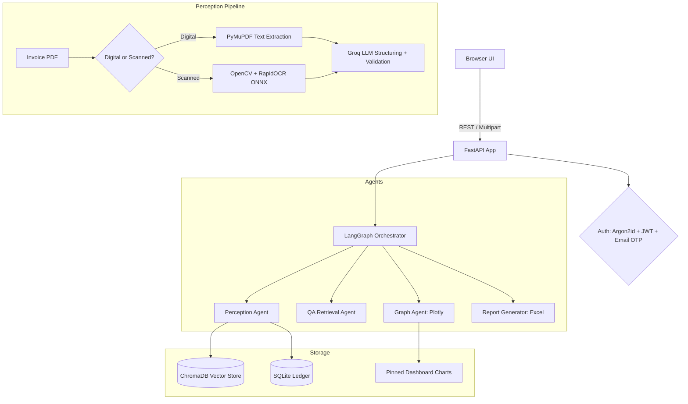

# AutoInvoice: AI Invoice Assistant with a Multi-Agent Ledger

[](https://fastapi.tiangolo.com)
[](https://www.python.org/)
[](https://www.langchain.com/)
[](https://www.trychroma.com/)
[](https://www.docker.com/)
[](LICENSE)

Upload any invoice PDF, digital or scanned, and AutoInvoice reads it, extracts the vendor, line items, tax and payment status, files it into a searchable ledger, and answers questions about your spending in plain English. Ask for a chart in words and it builds one you can pin to your dashboard.

**Live demo:** https://autoinvoice-app.duckdns.org
Create an account with your email (OTP verification), upload an invoice, and try the copilot.

The interface uses a paper-invoice design language: parchment palette (`#F6F1E7`), Fraunces serif headings, IBM Plex Mono figures, and rubber-stamp status badges.

---

## What it does

- **Invoice intake:** PDF upload with two extraction paths. Digital PDFs are parsed directly with PyMuPDF; scanned pages go through RapidOCR (ONNX) with OpenCV preprocessing.
- **LLM structuring:** Groq (default model `openai/gpt-oss-120b`) converts raw text into a validated invoice record. Structuring runs with retries and strict validation, so a failed extraction returns an error instead of silently saving an empty record.
- **Ledger and dashboard:** totals, settlement ratio, spend trajectory, top vendors, and a full invoice ledger, all scoped to your account.
- **Chat copilot:** multi-agent assistant (LangGraph) with persistent conversation memory. It answers from your actual ledger data indexed in ChromaDB, generates Excel reports, and builds charts on request.
- **Pinnable charts:** describe a chart in natural language ("top 5 vendors by spend", "payment status distribution") and pin it to the dashboard. Pinned charts are saved per user.
- **Accounts and security:** signup with email OTP verification (Brevo), Argon2id password hashing, JWT access tokens with rotating refresh cookies, and strict per-user isolation of invoices, chats and charts.

## How it works



## Engineering notes

- **Speed:** invoice processing went from about 48 seconds to 3 to 9 seconds per upload. The wins came from an OCR engine singleton (no model reload per request), a direct-text fast path for digital PDFs, lower OCR render DPI for scans, and moving blocking work off the event loop with `asyncio.to_thread`.
- **Correctness under failure:** LLM structuring uses a larger token budget, JSON salvage, and up to 3 retries. If structuring still fails, the upload returns HTTP 422 and nothing is stored.
- **Tenant isolation:** vector document IDs and database uniqueness are scoped per user (`(user_id, file_name)`), verified by two-account testing after a cross-user overwrite bug was found and fixed.
- **Production deployment:** Docker on AWS Lightsail, Caddy reverse proxy with automatic Let's Encrypt HTTPS, data on a persistent volume, health-checked restarts.

## Tech stack

| Layer | Technology |
|---|---|
| API | FastAPI, Uvicorn, Pydantic |
| Agents | LangGraph, LangChain |
| LLM | Groq API (`openai/gpt-oss-120b` default) |
| OCR | RapidOCR (ONNX Runtime), OpenCV, PyMuPDF |
| Vector store | ChromaDB |
| Database | SQLite (SQLAlchemy + Alembic migrations) |
| Auth | Argon2id, PyJWT, Brevo transactional email |
| Frontend | Vanilla JS, Plotly, custom paper-invoice CSS |
| Packaging | Docker |

## Quick start

### Prerequisites

- Python 3.10 or newer, or Docker
- A Groq API key (https://console.groq.com)
- A Brevo API key and a verified sender email, for OTP mail (https://app.brevo.com)

### Run locally

```bash
git clone https://github.com/shivrajbhosale9621-creator/AI_Invoice_Automation.git
cd AI_Invoice_Automation

python -m venv .venv
# Windows:  .venv\Scripts\activate
# Linux/macOS:  source .venv/bin/activate
pip install -r requirements.txt

cp .env.example .env   # then fill in your keys, see below

python -m uvicorn app.main:app --host 127.0.0.1 --port 5000
```

Open http://127.0.0.1:5000 and create an account.

### Run with Docker

```bash
docker build -t autoinvoice .
docker run -d --name autoinvoice \
  -p 5000:5000 \
  --env-file .env \
  -e CHAT_DB_PATH=/app/data/invoices.db \
  -e CHROMA_DB_PATH=/app/data/chroma_db \
  -e INBOX_DIR=/app/data/inbox \
  -v autoinvoice-data:/app/data \
  autoinvoice
```

Health check: `GET /api/health` returns `{"status":"ok"}`.

## Environment variables

Set these in `.env` (see `.env.example` for the full template):

| Variable | Purpose |
|---|---|
| `GROQ_API_KEY` | Groq API key for LLM structuring and agents |
| `GROQ_MODEL_NAME` | Model name, default `openai/gpt-oss-120b` |
| `BREVO_API_KEY` | Brevo API key for OTP emails |
| `BREVO_SENDER_EMAIL` | Verified sender address in Brevo |
| `BREVO_SENDER_NAME` | Sender display name, default `AutoInvoice Ledger` |
| `JWT_SECRET` | Secret for signing JWTs (use a long random value in production) |
| `COOKIE_SECURE` | Set `true` when serving over HTTPS |
| `DATABASE_URL` / `SYNC_DATABASE_URL` | SQLite URLs for the app database |
| `CHAT_DB_PATH` | Path of the SQLite file used by the app and chat store |
| `CHROMA_DB_PATH` | ChromaDB persistence directory |
| `INBOX_DIR` | Directory where uploaded invoice files are kept |
| `PORT` | Port the app listens on, default `5000` |

## Project structure

```
AI_Invoice_Automation/
├── app/
│   ├── main.py            # FastAPI entrypoint and route wiring
│   ├── core/              # Config, database, security (Argon2id + JWT), rate limiting
│   ├── models/            # SQLAlchemy models: User, Invoice, OTP, Token
│   ├── routers/           # Auth endpoints (signup, login, OTP)
│   └── services/          # OTP service and Brevo mailer
├── ocr_engine.py          # PyMuPDF fast path, RapidOCR singleton, LLM structuring
├── orchestrator.py        # LangGraph multi-agent coordinator
├── qa_agent.py            # Ledger QA over ChromaDB retrieval
├── graph_agent.py         # Natural-language to Plotly chart engine
├── report_generator.py    # Excel report generation
├── vector_store.py        # ChromaDB indexing and per-user scoping
├── chat_store.py          # Conversation and pinned-chart storage
├── conversation_memory.py # LangGraph memory helpers
├── sqlite_checkpointer.py # LangGraph checkpointer on SQLite
├── alembic/               # Database migrations
├── static/                # CSS and modular JS (app, api, upload, chat, charts)
├── templates/             # index.html (paper-invoice UI)
├── tests/                 # Pytest suites: auth, charts, memory, endpoints
├── Dockerfile
└── requirements.txt
```

## Tests

```bash
pytest tests/test_auth.py -v                     # auth and OTP flows
pytest tests/test_custom_dashboard_charts.py -v  # pinned charts end to end
pytest tests/test_memory.py -v                   # conversation memory
```

Some suites need a live `GROQ_API_KEY` in `.env`.

## License

MIT License. See [LICENSE](LICENSE).

Built by Shivraj Bhosale.
