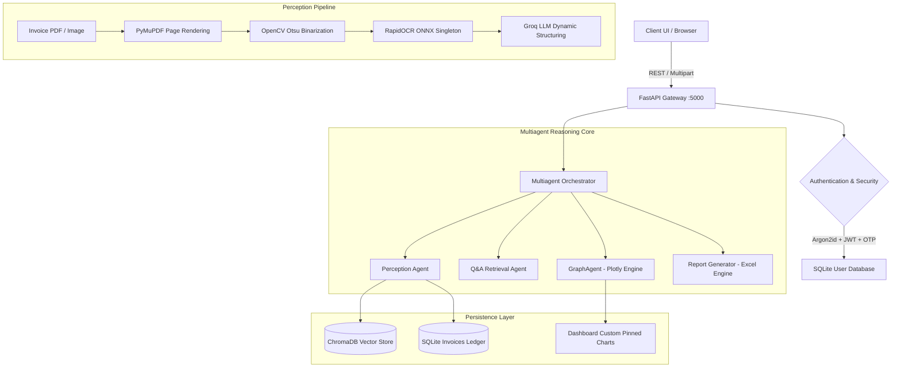

# AutoInvoice Intelligence — AI Multiagent Invoice Automation System

[](https://fastapi.tiangolo.com)
[](https://www.python.org/)
[](https://www.langchain.com/)
[](https://www.trychroma.com/)
[](https://www.docker.com/)
[](LICENSE)

An enterprise-grade document processing, multi-agent conversational analytics, and financial ledger platform. It automates end-to-end invoice intake, computer vision binarization, layout-aware OCR extraction, dynamic schema structuring via Groq LLMs, vector database indexing, natural language chart generation, and financial reporting.

Designed with a tactile, editorial **Paper Invoice Aesthetic** (`#F6F1E7` parchment palette, Fraunces serif headers, IBM Plex Mono tabular figures, and stamped verification badges).

---

## Technical Architecture



---

## Key Features

1. **High-Speed Perception Pipeline**:
   - **OpenCV Otsu Binarization**: Automatically cleans lighting defects, enhances small font contrast, and segments text boundaries.
   - **RapidOCR ONNX Singleton**: Optimized local inference using PaddleOCR ONNX models cached in memory, eliminating redundant downloads and session reloads (**41.6% latency reduction**).
   - **Dynamic Schema Structuring**: Uses Groq LLMs to normalize raw text into clean JSON without rigid schema restrictions.

2. **Custom Pinned Dashboard Charts**:
   - Create and pin interactive Plotly visualizations directly from natural language prompts (e.g., *"Show top 5 vendors by spend"*, *"Payment status distribution"*, *"Spend timeline over the last 6 months"*).
   - Saved and isolated per user in SQLite, rendered interactively on every dashboard session.
   - Two-step tactile inline deletion (`DELETE ✕` &rarr; `CONFIRM? ✕`).

3. **Enterprise Multi-Tenant Security**:
   - User authentication via Argon2id password hashing and PyJWT bearer tokens with HttpOnly refresh cookies.
   - 6-digit email OTP verification via Brevo (Sendinblue) API with rate limiting and replay prevention.
   - Strict tenant isolation: invoices, chat transcripts, and custom dashboard charts are strictly scoped to the authenticated user ID.

4. **Multiagent Conversational Copilot**:
   - Conversational assistant with multi-turn persistent SQLite memory (`LangGraph` checkpointer).
   - Live progressive animated status indicator during agent reasoning.
   - Automated Excel voucher downloads and embedded chart visualizations.

5. **Container & Production Ready**:
   - Optimized `Dockerfile` running Uvicorn on port 5000 with layer caching and health check endpoints.
   - Lightweight dependencies (PyTorch-free ChromaDB ONNX runtime).

---

## Directory Structure

```
AI_Invoice_Automation/
├── app/
│   ├── main.py                  # FastAPI application entrypoint & REST routes
│   ├── core/                    # Security, JWT, config & rate limiting
│   ├── models/                  # SQLAlchemy ORM models (User, OTP, RefreshToken)
│   └── routers/                 # Authentication endpoints (/auth/signup, /login, /otp)
├── config.py                    # Global configuration & environment loader
├── ocr_engine.py                # OpenCV binarization, RapidOCR singleton & JSON structuring
├── orchestrator.py              # LangGraph multiagent coordinator
├── qa_agent.py                  # Semantic vector search & RAG question answering
├── graph_agent.py               # Natural language Plotly visualization engine
├── report_generator.py          # LLM date filter & Excel spreadsheet generator
├── vector_store.py              # ChromaDB client & semantic similarity search
├── chat_store.py                # SQLite conversation memory & pinned charts schema
├── static/                      # Static assets (vanilla CSS & modular JS)
│   ├── css/style.css            # Paper Invoice design tokens & responsive styles
│   └── js/                      # Modular client logic (app.js, api.js, upload.js, chat.js, charts.js)
├── templates/
│   └── index.html               # Paper Invoice bento UI template
├── tests/                       # Automated test suites (Auth, Charts E2E, Memory)
├── Dockerfile                   # Production container definition
├── .dockerignore                # Image build exclusions
└── requirements.txt             # Minimal, production-pinned Python dependencies
```

---

## Getting Started

### 1. Prerequisites
- Python 3.10+ (tested on Python 3.10, 3.11, 3.12)
- Groq API Key ([console.groq.com](https://console.groq.com))
- Brevo API Key (for transactional OTP emails; optional in mock mode)

### 2. Installation

```bash
# Clone the repository
git clone https://github.com/shivrajbhosale9621-creator/AI_Invoice_Automation.git
cd AI_Invoice_Automation

# Create and activate virtual environment
python -m venv .venv
# On Windows:
.venv\Scripts\activate
# On Linux/macOS:
source .venv/bin/activate

# Install dependencies
pip install -r requirements.txt
```

### 3. Environment Configuration

Copy the example environment file and set your keys:

```bash
cp .env.example .env
```

Edit `.env`:
```env
GROQ_API_KEY=gsk_your_groq_api_key_here
GROQ_MODEL_NAME=openai/gpt-oss-120b
JWT_SECRET=your_super_secret_jwt_key_min_32_characters
BREVO_API_KEY=xkeysib_your_brevo_api_key
BREVO_SENDER_EMAIL=your_verified_sender@example.com
DATABASE_URL=sqlite+aiosqlite:///./invoices.db
SYNC_DATABASE_URL=sqlite:///./invoices.db
```

### 4. Running Locally

Start the FastAPI application with Uvicorn:

```bash
python -m uvicorn app.main:app --host 127.0.0.1 --port 5000 --reload
```

Open your browser at:
```
http://127.0.0.1:5000
```

---

## Running with Docker

Build and launch the lightweight production container:

```bash
# Build Docker image
docker build -t ai-invoice-automation .

# Run container on port 5000
docker run -d \
  -p 5000:5000 \
  --name invoice-app \
  --env-file .env \
  ai-invoice-automation
```

---

## Running Automated Tests

Run the full pytest suite:

```bash
# Test Authentication & OTP flows
pytest tests/test_auth.py -v

# Test Custom Pinned Dashboard Charts E2E
pytest tests/test_custom_dashboard_charts.py -v

# Test Conversation Memory & LangGraph Persistence
pytest tests/test_memory.py -v
```

---

## License

This project is licensed under the MIT License — see the [LICENSE](LICENSE) file for details.
