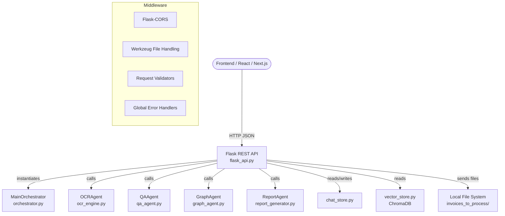

# Flask REST API Plan — AI Invoice Automation

## 1. Architecture Overview



---

## 2. File Structure

```
AI_Invoice_Automation/
├── flask_api.py          ← NEW: Flask REST API (single file, cleanly separated)
├── orchestrator.py       (unchanged – used by /chat endpoint)
├── qa_agent.py           (unchanged)
├── graph_agent.py        (unchanged)
├── report_generator.py   (unchanged)
├── ocr_engine.py         (unchanged)
├── vector_store.py       (unchanged)
├── chat_store.py         (unchanged)
├── config.py             (unchanged)
├── app.py                (unchanged Streamlit – kept side-by-side)
└── requirements.txt      ← ADD: flask, flask-cors
```

> **Key Design Decision:** `flask_api.py` is a **thin API layer only**. It delegates all business logic to the existing agent classes. No business logic is duplicated in the API file.

---

## 3. Dependencies to Add

```txt
# Add to requirements.txt
flask>=3.0.0
flask-cors>=4.0.0
werkzeug>=3.0.0        # already bundled with Flask, explicit for clarity
```

---

## 4. Orchestrator Session Management

### The Problem
`MainOrchestrator.__init__` is **expensive** — it builds 4 agent instances and a LangGraph ReAct agent. Creating one per request would be extremely slow and wasteful.

### The Solution: Per-Conversation Singleton Cache
```python
_orchestrator_cache: dict[str, MainOrchestrator] = {}
_cache_lock = threading.Lock()

def get_orchestrator(conversation_id: str, user_id: str) -> MainOrchestrator:
    cache_key = f"{user_id}:{conversation_id}"
    with _cache_lock:
        if cache_key not in _orchestrator_cache:
            _orchestrator_cache[cache_key] = MainOrchestrator(
                user_id=user_id,
                conversation_id=conversation_id,
            )
        return _orchestrator_cache[cache_key]
```
- One `MainOrchestrator` per `(user_id, conversation_id)` pair, shared across requests for that conversation.
- Thread-safe via `threading.Lock`.
- The orchestrator itself uses SQLite-backed LangGraph checkpointing and `chat_store`, both of which are thread-safe for concurrent reads (single writer via SQLite WAL mode).

---

## 5. Complete Endpoint Specification

### 5.1 Health Check

| Field | Value |
|---|---|
| **Method** | `GET` |
| **Path** | `/api/health` |
| **Auth** | None |
| **Purpose** | Kubernetes/Docker liveness probe, uptime monitoring |

**Response `200`:**
```json
{ "status": "ok", "timestamp": "2025-01-15T10:30:00Z" }
```

---

### 5.2 Chat — Orchestrator Run

| Field | Value |
|---|---|
| **Method** | `POST` |
| **Path** | `/api/chat` |
| **Content-Type** | `application/json` |
| **Purpose** | Send a message to the `MainOrchestrator`, get a response. Supports tool dispatch (OCR, QA, graph, report). |

**Request body:**
```json
{
  "user_id": "user_abc",
  "conversation_id": "conv_xyz",    // Optional: omit to create new conversation
  "message": "Show me top 5 vendors by spend",
  "idempotency_key": "msg_unique_001"  // Optional: prevents duplicate messages on retry
}
```

**Validation:**
- `message`: required, non-empty string, max 4000 chars
- `user_id`: required, non-empty string, max 128 chars
- `conversation_id`: optional string, max 128 chars
- `idempotency_key`: optional string, max 256 chars

**Response `200`:**
```json
{
  "status": "success",
  "conversation_id": "conv_xyz",
  "response": "Here are the top 5 vendors by total spend: ...",
  "user_id": "user_abc"
}
```

**Response `400`:**
```json
{ "status": "error", "error": "message field is required and cannot be empty" }
```

**Response `500`:**
```json
{ "status": "error", "error": "Agent invocation failed: <detail>" }
```

**Bug-prevention notes:**
- The `orchestrator.run()` method already handles its own `try/except` and returns a string. We wrap a second `try/except` at the API layer to catch any uncaught infra-level exceptions.
- `conversation_id` is passed to `get_or_create_conversation` inside `MainOrchestrator.__init__` — if it doesn't exist, a new one is created automatically. No ID conflict possible.
- `idempotency_key` is forwarded to `save_message()` which has a `UNIQUE INDEX` on it in SQLite — safe for retries.

---

### 5.3 Upload Invoice File

| Field | Value |
|---|---|
| **Method** | `POST` |
| **Path** | `/api/invoice/upload` |
| **Content-Type** | `multipart/form-data` |
| **Purpose** | Upload a PDF/image invoice, save to `invoices_to_process/`, optionally trigger OCR processing |

**Form fields:**
| Field | Type | Required | Description |
|---|---|---|---|
| `file` | file | ✅ | PDF, PNG, JPG, JPEG, BMP, TIFF |
| `process_now` | string | ❌ | `"true"` to immediately OCR+index after upload |

**Validation:**
- File extension must be in `{.pdf, .png, .jpg, .jpeg, .bmp, .tiff}` — checked **before** saving to disk
- File size limit: 20 MB (configured via `MAX_CONTENT_LENGTH = 20 * 1024 * 1024`)
- Filename sanitized via `werkzeug.utils.secure_filename()` — **prevents path traversal attacks**

**Response `200` (upload only):**
```json
{
  "status": "success",
  "message": "File 'invoice_001.pdf' uploaded successfully.",
  "file_name": "invoice_001.pdf",
  "file_path": "invoices_to_process/invoice_001.pdf",
  "processed": false
}
```

**Response `200` (upload + process):**
```json
{
  "status": "success",
  "message": "File uploaded and indexed successfully.",
  "file_name": "invoice_001.pdf",
  "file_path": "invoices_to_process/invoice_001.pdf",
  "processed": true,
  "ocr_result": {
    "status": "success",
    "message": "Successfully extracted and indexed 'invoice_001.pdf' into vector storage.",
    "file_name": "invoice_001.pdf"
  }
}
```

**Response `400`:**
```json
{ "status": "error", "error": "Unsupported file type '.docx'. Allowed: pdf, png, jpg, jpeg, bmp, tiff" }
```

**Response `413`:**
```json
{ "status": "error", "error": "File too large. Maximum allowed size is 20 MB." }
```

**Bug-prevention notes:**
- `secure_filename()` prevents `../../etc/passwd` style paths.
- Extension check on the **original** filename extension, not MIME type (MIME can be spoofed).
- File is only saved after validation passes — no orphan files on validation error.
- `process_now` OCR call is wrapped in `try/except` so upload success is reported even if OCR fails partially.

---

### 5.4 Process Invoice (OCR + Index)

| Field | Value |
|---|---|
| **Method** | `POST` |
| **Path** | `/api/invoice/process` |
| **Content-Type** | `application/json` |
| **Purpose** | Trigger OCR + indexing for an already-uploaded file (or any server-side path) |

**Request body:**
```json
{ "file_path": "invoices_to_process/invoice_001.pdf" }
```

**Validation:**
- `file_path`: required string
- Path must resolve within `invoices_to_process/` directory — **path traversal guard** using `os.path.abspath` comparison
- File must exist on disk

**Response `200`:**
```json
{
  "status": "success",
  "message": "Successfully extracted and indexed 'invoice_001.pdf' into vector storage.",
  "file_name": "invoice_001.pdf"
}
```

**Bug-prevention notes:**
- **Path traversal guard:** `os.path.abspath(file_path)` is compared to ensure it starts with `os.path.abspath(DEFAULT_INBOX_DIR)`. Requests pointing outside are rejected with `403`.

---

### 5.5 Process All Invoices in Inbox

| Field | Value |
|---|---|
| **Method** | `POST` |
| **Path** | `/api/invoice/process-all` |
| **Content-Type** | `application/json` (empty body OK) |
| **Purpose** | Batch-process all files in `invoices_to_process/` |

**Response `200`:**
```json
{
  "status": "success",
  "message": "Processed 5/6 invoice(s) into vector storage.",
  "total_files": 6,
  "successful": ["inv1.pdf", "inv2.pdf", "inv3.pdf", "inv4.pdf", "inv5.pdf"],
  "failed": ["corrupted.pdf"]
}
```

---

### 5.6 QA — Answer Invoice Question

| Field | Value |
|---|---|
| **Method** | `POST` |
| **Path** | `/api/qa/ask` |
| **Content-Type** | `application/json` |
| **Purpose** | Direct QA agent call (bypasses orchestrator, lower latency for simple queries) |

**Request body:**
```json
{
  "question": "What is the total spend for vendor ABC Corp?",
  "chat_history": []    // Optional: array of {role, content} objects
}
```

**Validation:**
- `question`: required, non-empty string, max 2000 chars
- `chat_history`: optional list, max 20 items

**Response `200`:**
```json
{
  "status": "success",
  "answer": "The total spend for ABC Corp is $45,230.00 across 7 invoices.",
  "retrieval_mode": "matrix"
}
```

---

### 5.7 Get All Invoices (Dashboard Data)

| Field | Value |
|---|---|
| **Method** | `GET` |
| **Path** | `/api/invoices` |
| **Purpose** | Return all stored invoices as JSON (used for dashboard KPIs, tables) |

**Query params:**
| Param | Type | Description |
|---|---|---|
| `include_ids` | bool | Include internal ChromaDB `_doc_id` field. Default: `false` |

**Response `200`:**
```json
{
  "status": "success",
  "count": 27,
  "invoices": [
    {
      "invoice_number": "INV-001",
      "vendor_name": "ABC Corp",
      "invoice_date": "2025-01-10",
      "due_date": "2025-02-10",
      "total_amount": 5230.00,
      "currency": "USD",
      "payment_status": "Paid"
    }
  ]
}
```

---

### 5.8 Delete Invoice

| Field | Value |
|---|---|
| **Method** | `DELETE` |
| **Path** | `/api/invoice/<doc_id>` |
| **Purpose** | Remove a single invoice from ChromaDB by its doc ID |

**Path param:**
- `doc_id`: ChromaDB document ID (the `_doc_id` field from invoice records)

**Validation:**
- `doc_id` must be a non-empty string (max 256 chars) — validated in URL route, rejecting empty strings

**Response `200`:**
```json
{ "status": "success", "message": "Invoice deleted successfully.", "doc_id": "abc123" }
```

**Response `404`:**
```json
{ "status": "error", "error": "Invoice with doc_id 'abc123' not found." }
```

---

### 5.9 Generate Excel Report

| Field | Value |
|---|---|
| **Method** | `POST` |
| **Path** | `/api/report/excel` |
| **Content-Type** | `application/json` |
| **Purpose** | Generate an Excel report, return the file as a download |

**Request body:**
```json
{
  "query": "All invoices from January 2025",
  "download": true   // true = return file as download, false = return file path
}
```

**Validation:**
- `query`: required, non-empty string, max 1000 chars

**Response `200` (download=true):**
- Returns binary Excel file with headers:
  ```
  Content-Type: application/vnd.openxmlformats-officedocument.spreadsheetml.sheet
  Content-Disposition: attachment; filename="invoice_report_20250115_103045.xlsx"
  ```

**Response `200` (download=false):**
```json
{
  "status": "success",
  "message": "Excel report with 12 records created.",
  "file_path": "/abs/path/to/invoice_report.xlsx",
  "record_count": 12
}
```

**Bug-prevention notes:**
- Unique timestamped filename per request prevents file collisions on concurrent report generation.
- File is written to a `reports/` subdirectory (created if not exists), never to the project root.
- After sending the file (`send_file`), the temp file is deleted via a `@after_this_request` hook to prevent disk accumulation.

---

### 5.10 Generate Graph / Chart

| Field | Value |
|---|---|
| **Method** | `POST` |
| **Path** | `/api/graph/generate` |
| **Content-Type** | `application/json` |
| **Purpose** | Generate a Plotly chart from a natural language prompt. Returns JSON figure data. |

**Request body:**
```json
{
  "prompt": "Show total spend by vendor as a bar chart",
  "graph_type": "custom"   // "knowledge_graph" | "custom"
}
```

**Validation:**
- `prompt`: required (for `graph_type=custom`), max 1000 chars
- `graph_type`: must be one of `["knowledge_graph", "custom"]`

**Response `200`:**
```json
{
  "status": "success",
  "graph_type": "custom",
  "plotly_json": { "data": [...], "layout": {...} }
}
```

**Bug-prevention notes:**
- `plotly_json` is generated via `fig.to_json()` → `json.loads()` so it's always a valid dict, never a raw string.
- `GraphAgent.run()` returns `{"status": ..., "figure": fig, "message": ...}`. We call `fig.to_dict()` only if status is `"success"` and `figure` is not `None`.
- If `GraphAgent` raises, we catch and return `500`.

---

### 5.11 Get Conversation History

| Field | Value |
|---|---|
| **Method** | `GET` |
| **Path** | `/api/chat/history/<conversation_id>` |
| **Purpose** | Retrieve message history for a conversation |

**Query params:**
| Param | Type | Description |
|---|---|---|
| `user_id` | string | Required — enforces user isolation |
| `limit` | int | Max messages to return. Default: 50, max: 200 |

**Validation:**
- `user_id`: required query param
- `limit`: clamped to `[1, 200]`
- Conversation ownership is validated: if `conversation_id` exists but belongs to a different `user_id`, return `403`

**Response `200`:**
```json
{
  "status": "success",
  "conversation_id": "conv_xyz",
  "messages": [
    { "role": "user", "content": "Hello", "created_at": "2025-01-15T10:00:00Z" },
    { "role": "assistant", "content": "Hi! How can I help?", "created_at": "2025-01-15T10:00:01Z" }
  ],
  "count": 2
}
```

---

### 5.12 List User Conversations

| Field | Value |
|---|---|
| **Method** | `GET` |
| **Path** | `/api/chat/conversations` |
| **Purpose** | List all conversations for a user |

**Query params:**
| Param | Type | Description |
|---|---|---|
| `user_id` | string | Required |

**Response `200`:**
```json
{
  "status": "success",
  "user_id": "user_abc",
  "conversations": [
    {
      "conversation_id": "conv_xyz",
      "title": null,
      "created_at": "2025-01-15T10:00:00Z",
      "updated_at": "2025-01-15T10:05:00Z"
    }
  ],
  "count": 1
}
```

---

## 6. Middleware & Cross-Cutting Concerns

### 6.1 CORS

```python
from flask_cors import CORS
CORS(app, resources={r"/api/*": {"origins": "*"}})
# In production, replace "*" with specific frontend domain
```

### 6.2 Global Error Handlers

```python
@app.errorhandler(400)
def bad_request(e):
    return jsonify({"status": "error", "error": str(e.description)}), 400

@app.errorhandler(404)
def not_found(e):
    return jsonify({"status": "error", "error": "Endpoint not found"}), 404

@app.errorhandler(413)
def request_too_large(e):
    return jsonify({"status": "error", "error": "File too large. Max 20MB."}), 413

@app.errorhandler(500)
def internal_error(e):
    return jsonify({"status": "error", "error": "Internal server error"}), 500
```

### 6.3 Request Validation Helper

```python
def require_json_fields(data: dict, required: list[str]) -> tuple[bool, str]:
    """Returns (is_valid, error_message)."""
    for field in required:
        if field not in data or not str(data[field]).strip():
            return False, f"'{field}' is required and cannot be empty"
    return True, ""
```

### 6.4 File Upload Configuration

```python
app.config["MAX_CONTENT_LENGTH"] = 20 * 1024 * 1024   # 20 MB
ALLOWED_EXTENSIONS = {".pdf", ".png", ".jpg", ".jpeg", ".bmp", ".tiff"}

def allowed_file(filename: str) -> bool:
    ext = os.path.splitext(filename)[1].lower()
    return ext in ALLOWED_EXTENSIONS
```

### 6.5 Path Traversal Guard

```python
def safe_file_path(user_path: str, base_dir: str) -> str | None:
    """Return absolute path only if it's within base_dir, else None."""
    abs_path = os.path.abspath(os.path.join(base_dir, os.path.basename(user_path)))
    if not abs_path.startswith(os.path.abspath(base_dir)):
        return None
    return abs_path
```

### 6.6 Logging

```python
import logging
logging.basicConfig(
    level=logging.INFO,
    format="%(asctime)s [%(levelname)s] %(name)s: %(message)s"
)
logger = logging.getLogger("flask_api")
```

---

## 7. Thread Safety Analysis

| Component | Thread Safe? | Notes |
|---|---|---|
| `ChromaDB PersistentClient` | ✅ Yes | Thread-safe by design |
| `MainOrchestrator` (per conv) | ✅ Yes | One instance per conversation, conversations are isolated |
| `SqliteCheckpointer` | ✅ Yes | Uses WAL mode + connection-per-thread pattern |
| `chat_store.py` | ✅ Yes | Uses `contextmanager` with `sqlite3.connect()` (new conn per call) |
| `OCRAgent` | ✅ Yes | Stateless class, no shared mutable state |
| `QAAgent` | ✅ Yes | Stateless class |
| `GraphAgent` | ✅ Yes | Stateless class |
| `ReportAgent` | ✅ Yes | Stateless class, file paths are request-unique |
| `_orchestrator_cache` dict | ✅ Yes | Protected by `threading.Lock()` |
| Report file writes | ✅ Yes | Timestamped unique filenames prevent collision |

---

## 8. Complete Endpoint Summary

| # | Method | Path | Agent/Module | Purpose |
|---|---|---|---|---|
| 1 | `GET` | `/api/health` | — | Liveness check |
| 2 | `POST` | `/api/chat` | `MainOrchestrator` | Send message, get response |
| 3 | `POST` | `/api/invoice/upload` | `OCRAgent` (optional) | Upload invoice file |
| 4 | `POST` | `/api/invoice/process` | `OCRAgent` | OCR + index one file |
| 5 | `POST` | `/api/invoice/process-all` | `OCRAgent` | Batch OCR + index all |
| 6 | `POST` | `/api/qa/ask` | `QAAgent` | Direct QA query |
| 7 | `GET` | `/api/invoices` | `vector_store` | Fetch all invoices |
| 8 | `DELETE` | `/api/invoice/<doc_id>` | `vector_store` | Delete one invoice |
| 9 | `POST` | `/api/report/excel` | `ReportAgent` | Generate Excel report |
| 10 | `POST` | `/api/graph/generate` | `GraphAgent` | Generate chart/graph |
| 11 | `GET` | `/api/chat/history/<conv_id>` | `chat_store` | Get conversation history |
| 12 | `GET` | `/api/chat/conversations` | `chat_store` | List user conversations |

---

## 9. Implementation Plan (Step by Step)

1. **Add dependencies** to `requirements.txt` (`flask`, `flask-cors`)
2. **Create `flask_api.py`** with:
   - App factory pattern, config loading from `config.py`
   - CORS middleware
   - `_orchestrator_cache` + `threading.Lock`
   - All 12 endpoints implemented
   - All validators, guards, and error handlers
3. **Create `reports/` directory** (add to `.gitignore`)
4. **Test each endpoint** with curl/Postman
5. **Update `requirements.txt`**

---

## 10. Potential Bugs Pre-Identified & Mitigated

| # | Risk | Mitigation |
|---|---|---|
| 1 | **Path traversal** on file upload/process | `secure_filename()` + `abspath` guard |
| 2 | **Concurrent orchestrator creation** for same conv | `threading.Lock()` on cache dict |
| 3 | **File collision** on concurrent report generation | Timestamp + random suffix in filename |
| 4 | **Disk accumulation** of report files | `@after_this_request` cleanup after download |
| 5 | **Empty `doc_id`** in DELETE route | Route regex restricts to non-empty strings |
| 6 | **Large `limit`** in history endpoint | Clamped to `[1, 200]` |
| 7 | **Missing `user_id`** bypassing isolation | `user_id` required in all chat endpoints |
| 8 | **ChromaDB import order** (OpenMP conflict) | `config.py` already sets `KMP_DUPLICATE_LIB_OK` before any import |
| 9 | **Plotly figure serialization** (`figure` may be None) | Null check before calling `.to_dict()` |
| 10 | **413 not caught as JSON** | `@app.errorhandler(413)` registered globally |
| 11 | **Unhandled exceptions leak stack traces** | `@app.errorhandler(500)` returns safe JSON message |
| 12 | **Duplicate messages on retry** | `idempotency_key` forwarded to `save_message()` |
