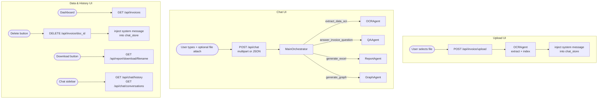

# Flask REST API Plan — AI Invoice Automation (Final)

## Core Architecture Principle

Two separate UIs, two distinct flows. The orchestrator is the brain for conversational
intent. Direct OCR bypass exists only when user intent is unambiguous (Upload UI).



---

## Why Two Separate Upload Flows?

| Scenario | UI | Flow | Why? |
|---|---|---|---|
| User opens Upload page, picks a file, clicks Upload | **Upload UI** | Direct → OCRAgent → index | Intent is 100% clear: add to database. No orchestrator needed. Saves LLM tokens. |
| User is chatting and attaches a file with a message | **Chat UI** | File + message → Orchestrator | Intent is ambiguous. Orchestrator reads the message and decides. |

### Chat UI upload examples — orchestrator decides:

| User says | Orchestrator action |
|---|---|
| *"Add this invoice to the database"* | Calls `extract_data_ocr(file)` |
| *"Do we already have this invoice in the system?"* | Calls `extract_data_ocr` to parse, then `answer_invoice_question` to check for duplicates |
| *"What is the total amount on this invoice?"* | Calls `extract_data_ocr` to read the file, answers from result |
| *(file only, no message)* | Asks: *"What would you like to do with this invoice?"* |

---

## How the Orchestrator Stays Informed

After every operation that changes the data state, a **system message is injected into
`chat_store`** for the active conversation. The orchestrator sees this in its context
window on the next `/api/chat` call — no extra API calls needed.

### On Upload (Upload UI):
```
[SYSTEM] Invoice uploaded and indexed successfully.
File: invoice_001.pdf
Vendor: ABC Corp | Invoice #: INV-001 | Total: $5,230.00 | Date: 2025-01-10
Status: Paid | Currency: USD
It is now available for queries, reports, and graph generation.
```

### On Delete:
```
[SYSTEM] Invoice deleted from the vector store.
Invoice #: INV-001 | Vendor: ABC Corp | Total: $5,230.00
This invoice is no longer available for queries.
```

---

## File Structure

```
AI_Invoice_Automation/
├── flask_api.py              ← NEW: Flask REST API (thin layer)
├── orchestrator.py           (unchanged)
├── qa_agent.py               (unchanged)
├── graph_agent.py            (unchanged)
├── report_generator.py       (unchanged — minor: save reports to reports/)
├── ocr_engine.py             (unchanged)
├── vector_store.py           (unchanged)
├── chat_store.py             (unchanged)
├── config.py                 (unchanged)
├── invoices_to_process/      (existing upload inbox)
├── reports/                  ← NEW: Excel reports saved here
└── requirements.txt          ← ADD: flask, flask-cors
```

---

## Dependencies to Add

```txt
flask>=3.0.0
flask-cors>=4.0.0
```

---

## Orchestrator Session Cache

`MainOrchestrator.__init__` is expensive (builds 4 agent instances + LangGraph ReAct
agent). We cache one instance per `(user_id, conversation_id)`, shared across requests:

```python
_orchestrator_cache: dict[str, MainOrchestrator] = {}
_cache_lock = threading.Lock()

def get_orchestrator(conversation_id: str, user_id: str) -> MainOrchestrator:
    key = f"{user_id}:{conversation_id}"
    with _cache_lock:
        if key not in _orchestrator_cache:
            _orchestrator_cache[key] = MainOrchestrator(
                user_id=user_id,
                conversation_id=conversation_id,
            )
        return _orchestrator_cache[key]
```

---

## Complete Endpoint Specification (8 Endpoints)

---

### Endpoint 1 — Health Check

| | |
|---|---|
| **Method** | `GET` |
| **Path** | `/api/health` |
| **Purpose** | Docker / Kubernetes liveness probe |

**Response `200`:**
```json
{ "status": "ok", "timestamp": "2025-01-15T10:30:00Z" }
```

---

### Endpoint 2 — Chat (Main Orchestrator) ← PRIMARY ENDPOINT

| | |
|---|---|
| **Method** | `POST` |
| **Path** | `/api/chat` |
| **Content-Type** | `multipart/form-data` OR `application/json` |
| **Purpose** | All user queries: QA, report requests, graph requests, file analysis. Orchestrator decides which tool(s) to call. |

**Fields (multipart or JSON):**

| Field | Type | Required | Description |
|---|---|---|---|
| `user_id` | string | ✅ | Non-empty, max 128 chars |
| `message` | string | ✅ | User's text message, max 4000 chars |
| `conversation_id` | string | ❌ | Omit to create a new conversation |
| `idempotency_key` | string | ❌ | Deduplication token for retries |
| `file` | file | ❌ | Invoice file attached from Chat UI (PDF/PNG/JPG/JPEG/BMP/TIFF) |

**When a file is attached:**
1. File is saved to `invoices_to_process/<secure_filename>`
2. The file path is appended to the message context before passing to orchestrator:
   ```
   User message: "Do we have this invoice already?"
   [Attached file saved at: invoices_to_process/invoice_001.pdf]
   ```
3. Orchestrator reads the combined context and decides which tool(s) to call.

**Response `200`:**
```json
{
  "status": "success",
  "conversation_id": "conv_xyz",
  "response": "I checked the database — we already have Invoice INV-001 from ABC Corp dated 2025-01-10.",
  "user_id": "user_abc"
}
```

**Response `400`:**
```json
{ "status": "error", "error": "'message' is required and cannot be empty" }
```

**Response `500`:**
```json
{ "status": "error", "error": "Agent invocation failed: <detail>" }
```

**Bug-prevention notes:**
- `orchestrator.run()` has internal `try/except`. API layer wraps a second one for infra failures.
- File attached via chat is saved with `secure_filename()` before path is passed to orchestrator.
- Response always includes `conversation_id` so frontend can persist it for follow-up messages.
- `idempotency_key` forwarded to `save_message()` — SQLite `UNIQUE INDEX` prevents duplicate on retry.

---

### Endpoint 3 — Upload Invoice (Upload UI)

| | |
|---|---|
| **Method** | `POST` |
| **Path** | `/api/invoice/upload` |
| **Content-Type** | `multipart/form-data` |
| **Purpose** | Upload UI: save file + auto-OCR + index + notify orchestrator via system message. Intent is always clear here. |

**Form fields:**

| Field | Type | Required | Description |
|---|---|---|---|
| `file` | file | ✅ | PDF, PNG, JPG, JPEG, BMP, TIFF |
| `conversation_id` | string | ❌ | Which conversation to notify. If omitted, no system message is injected. |
| `user_id` | string | ❌ | Required if `conversation_id` is provided |

**Processing steps:**
1. Validate file extension and size
2. Save with `secure_filename()` to `invoices_to_process/`
3. Call `OCRAgent.process_and_index_invoice(file_path)` directly
4. If `conversation_id` provided: inject system message into `chat_store` with extracted invoice metadata

**Response `200`:**
```json
{
  "status": "success",
  "file_name": "invoice_001.pdf",
  "message": "Invoice uploaded, extracted, and indexed successfully.",
  "invoice_summary": {
    "vendor_name": "ABC Corp",
    "invoice_number": "INV-001",
    "total_amount": 5230.00,
    "invoice_date": "2025-01-10",
    "payment_status": "Paid"
  }
}
```

**Response `400` (bad extension):**
```json
{ "status": "error", "error": "Unsupported file type '.docx'. Allowed: pdf, png, jpg, jpeg, bmp, tiff" }
```

**Response `413` (too large):**
```json
{ "status": "error", "error": "File too large. Maximum allowed size is 20 MB." }
```

**Response `422` (OCR failed):**
```json
{
  "status": "error",
  "error": "File uploaded but OCR extraction failed: No text could be extracted from 'invoice_001.pdf'.",
  "file_name": "invoice_001.pdf"
}
```

**Bug-prevention notes:**
- `secure_filename()` prevents path traversal on the stored filename.
- Extension validated from original filename (not MIME — MIME can be spoofed).
- File only written to disk **after** validation — no orphan files on error.
- OCR result status is checked: if OCR fails, `422` is returned (file was saved but not indexed).
- System message injection is best-effort — failure to notify does NOT fail the upload response.

---

### Endpoint 4 — Get All Invoices (Dashboard)

| | |
|---|---|
| **Method** | `GET` |
| **Path** | `/api/invoices` |
| **Purpose** | Raw structured data for dashboard KPIs, tables, charts. No LLM needed. |

**Query params:**

| Param | Type | Default | Description |
|---|---|---|---|
| `include_ids` | bool | `false` | Include `_doc_id` field (needed for delete button) |

**Response `200`:**
```json
{
  "status": "success",
  "count": 27,
  "invoices": [
    {
      "invoice_number": "INV-001",
      "vendor_name": "ABC Corp",
      "invoice_date": "2025-01-10",
      "due_date": "2025-02-10",
      "total_amount": 5230.00,
      "currency": "USD",
      "payment_status": "Paid",
      "_doc_id": "chroma-abc123"
    }
  ]
}
```

---

### Endpoint 5 — Delete Invoice

| | |
|---|---|
| **Method** | `DELETE` |
| **Path** | `/api/invoice/<doc_id>` |
| **Purpose** | Remove invoice from ChromaDB and notify orchestrator via system message |

**Query params (for notification):**

| Param | Type | Required | Description |
|---|---|---|---|
| `conversation_id` | string | ❌ | Which conversation to notify. If omitted, no system message injected. |
| `user_id` | string | ❌ | Required if `conversation_id` is provided |

**Processing steps:**
1. Call `delete_invoice(doc_id)` from `vector_store.py`
2. If `conversation_id` provided: inject system message into `chat_store` with deleted invoice details

**Response `200`:**
```json
{
  "status": "success",
  "message": "Invoice deleted successfully.",
  "doc_id": "chroma-abc123"
}
```

**Response `404`:**
```json
{ "status": "error", "error": "Invoice not found." }
```

---

### Endpoint 6 — Download Excel Report

| | |
|---|---|
| **Method** | `GET` |
| **Path** | `/api/report/download/<filename>` |
| **Purpose** | Download a previously-generated Excel file. Binary stream back to browser. |

**Flow:**
1. User chats: *"Generate Excel report for Q1 2025"* → `/api/chat`
2. Orchestrator calls `generate_excel`, saves to `reports/invoice_report_<timestamp>.xlsx`
3. Orchestrator responds: *"Your report is ready. [Download](invoice_report_20250115.xlsx)"*
4. Frontend calls `GET /api/report/download/invoice_report_20250115.xlsx`

**Validation:**
- `filename` sanitized via `secure_filename()`
- `abspath` guard: resolved path must be inside `reports/` directory
- File must exist

**Response `200`:**
```
Content-Type: application/vnd.openxmlformats-officedocument.spreadsheetml.sheet
Content-Disposition: attachment; filename="invoice_report_20250115.xlsx"
<binary data>
```

**Response `404`:**
```json
{ "status": "error", "error": "Report file not found." }
```

**Bug-prevention notes:**
- `secure_filename()` + `abspath` guard = double protection against directory traversal.
- Reports saved to `reports/` directory (not project root) to avoid clutter.
- `ReportAgent.generate_report()` updated to save with `<timestamp>_<uuid4[:8]>.xlsx` suffix to prevent concurrent file collision.

---

### Endpoint 7 — Conversation History

| | |
|---|---|
| **Method** | `GET` |
| **Path** | `/api/chat/history/<conversation_id>` |
| **Purpose** | Retrieve message history for a conversation (for Chat UI display) |

**Query params:**

| Param | Type | Required | Description |
|---|---|---|---|
| `user_id` | string | ✅ | Enforces user isolation |
| `limit` | int | ❌ | Max messages. Default 50, clamped to `[1, 200]` |

**Response `200`:**
```json
{
  "status": "success",
  "conversation_id": "conv_xyz",
  "messages": [
    { "role": "user", "content": "Hello", "created_at": "2025-01-15T10:00:00Z" },
    { "role": "assistant", "content": "Hi! How can I help?", "created_at": "2025-01-15T10:00:01Z" },
    { "role": "system", "content": "[SYSTEM] Invoice 'invoice_001.pdf' indexed...", "created_at": "2025-01-15T10:01:00Z" }
  ],
  "count": 3
}
```

---

### Endpoint 8 — List User Conversations

| | |
|---|---|
| **Method** | `GET` |
| **Path** | `/api/chat/conversations` |
| **Purpose** | List all conversations for a user (for Chat UI sidebar) |

**Query params:**

| Param | Type | Required |
|---|---|---|
| `user_id` | string | ✅ |

**Response `200`:**
```json
{
  "status": "success",
  "user_id": "user_abc",
  "conversations": [
    {
      "conversation_id": "conv_xyz",
      "title": null,
      "created_at": "2025-01-15T10:00:00Z",
      "updated_at": "2025-01-15T10:05:00Z"
    }
  ],
  "count": 1
}
```

---

## Middleware & Cross-Cutting Concerns

### CORS
```python
from flask_cors import CORS
CORS(app, resources={r"/api/*": {"origins": "*"}})
# Production: replace "*" with specific frontend domain
```

### Global Error Handlers
```python
@app.errorhandler(400)  → JSON { status: error, error: description }
@app.errorhandler(404)  → JSON { status: error, error: "Endpoint not found" }
@app.errorhandler(413)  → JSON { status: error, error: "File too large. Max 20MB." }
@app.errorhandler(500)  → JSON { status: error, error: "Internal server error" }
```

### File Upload Config
```python
app.config["MAX_CONTENT_LENGTH"] = 20 * 1024 * 1024
ALLOWED_EXTENSIONS = {".pdf", ".png", ".jpg", ".jpeg", ".bmp", ".tiff"}
```

### Path Traversal Guard
```python
def safe_path(filename: str, base_dir: str) -> str | None:
    safe = os.path.abspath(os.path.join(base_dir, secure_filename(filename)))
    if not safe.startswith(os.path.abspath(base_dir)):
        return None
    return safe
```

### Request Validator
```python
def require_fields(data: dict, fields: list[str]) -> tuple[bool, str]:
    for f in fields:
        if not data.get(f) or not str(data[f]).strip():
            return False, f"'{f}' is required and cannot be empty"
    return True, ""
```

---

## Thread Safety Summary

| Component | Safe? | Notes |
|---|---|---|
| `_orchestrator_cache` | ✅ | Protected by `threading.Lock()` |
| `MainOrchestrator` per conversation | ✅ | Isolated by `(user_id, conversation_id)` |
| `ChromaDB PersistentClient` | ✅ | Thread-safe by design |
| `chat_store.py` | ✅ | New SQLite connection per call |
| `SqliteCheckpointer` | ✅ | WAL mode + connection-per-thread |
| `OCRAgent / QAAgent / GraphAgent / ReportAgent` | ✅ | All stateless classes |
| Report file writes | ✅ | `<timestamp>_<uuid>` filenames prevent collision |
| System message injection | ✅ | `save_message()` uses atomic SQLite transaction |

---

## Final Endpoint Summary

| # | Method | Path | Via Orchestrator? | Purpose |
|---|---|---|---|---|
| 1 | `GET` | `/api/health` | ❌ | Liveness probe |
| 2 | `POST` | `/api/chat` | ✅ **YES** | All queries + Chat UI file upload |
| 3 | `POST` | `/api/invoice/upload` | ❌ Direct OCR | Upload UI: auto OCR + index + notify |
| 4 | `GET` | `/api/invoices` | ❌ | Dashboard: all invoice data |
| 5 | `DELETE` | `/api/invoice/<doc_id>` | ❌ | Delete + notify orchestrator |
| 6 | `GET` | `/api/report/download/<filename>` | ❌ | Download Excel binary |
| 7 | `GET` | `/api/chat/history/<conv_id>` | ❌ | Chat history for UI |
| 8 | `GET` | `/api/chat/conversations` | ❌ | Conversation list for sidebar |

---

## Pre-Identified Bugs & Mitigations

| # | Risk | Mitigation |
|---|---|---|
| 1 | Path traversal on upload | `secure_filename()` + `abspath` base-dir guard |
| 2 | Path traversal on report download | Same double guard |
| 3 | Concurrent orchestrator creation for same conv | `threading.Lock()` on cache dict |
| 4 | Report file collision (concurrent requests) | `<timestamp>_<uuid[:8]>.xlsx` unique filenames |
| 5 | `413` not returned as JSON | `@app.errorhandler(413)` registered globally |
| 6 | Duplicate messages on retry | `idempotency_key` → SQLite UNIQUE index |
| 7 | `conversation_id` missing from response | Always returned in `/api/chat` response |
| 8 | ChromaDB OpenMP conflict on Windows | `config.py` sets `KMP_DUPLICATE_LIB_OK` before imports |
| 9 | Large `limit` in history | Clamped to `[1, 200]` server-side |
| 10 | Stack traces leaking to client | Global `@app.errorhandler(500)` returns safe JSON |
| 11 | MIME spoofing on upload | Extension checked from filename, not Content-Type header |
| 12 | Orphan files on upload validation failure | File written to disk only after all validation passes |
| 13 | System message injection failing silently | Wrapped in `try/except` — never fails the main response |
| 14 | Chat file attachment with no message | Orchestrator always receives message; if blank, return `400` |
